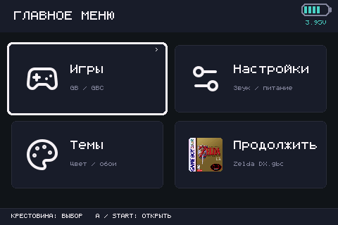
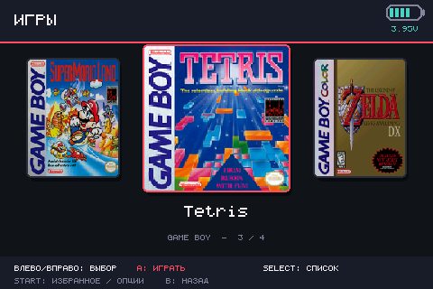
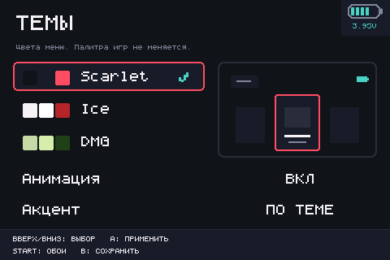
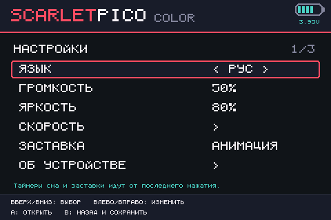

<p align="center"></p>
<p align="center"><a href="README.md">Русский</a> · <b>English</b></p>
<p align="center"><b>A small handheld. A big collection. One more game.</b><br>DIY Game Boy / Game Boy Color handheld, powered by RP2350.</p>
<p align="center">
  <a href="firmware/releases/2026-11-18-rp2350-3.6.3/ScarletPico-v3_6_3-RP2350.uf2"><b>Download 3.6.3 UF2</b></a> ·
  <a href="#install">Install</a> · <a href="#controls">Controls</a> · <a href="docs/USAGE.md">Detailed guide (RU)</a>
</p>

ScarletPico Color is a personal, hand-soldered handheld with physical buttons,
a 3.5-inch color display, speaker, microSD storage and a custom printed case.
It runs on a **microcontroller, not a Linux computer**. The current hardware is
**Waveshare RP2350-USB-A + 74HC165**; the RP2040 version is now historical.
GB/GBC are supported; NES, SNES and GBA are not included. Compatibility and
performance vary by game — there is no universal 60 FPS promise.

## On screen

<table>
  <tr><td><br><b>A clear home screen</b></td><td><br><b>Your collection, with cover art</b></td></tr>
  <tr><td><br><b>Make it yours</b></td><td><br><b>Set it up your way</b></td></tr>
</table>

These are **480 × 320 software captures of the actual 3.6.3 ARM UI code**,
with simulated LCD/SD/input and example battery data. Not physical display
photos, design mockups or on-device FPS measurements. Screens shown in
Russian; the firmware also has an English interface.

## Features

- Cover carousel, list and grid; favorites first, recent games and per-game profiles.
- Five manual state slots and automatic resume when a valid saved session exists.
- Enlarged selected tiles and a neutral outline: focus is not conveyed by color alone.
- Scarlet, Ice and DMG palettes, accent colors, optional SD wallpapers and motion toggle.
- Volume, brightness, idle timers, screensavers, screen sleep and confirmed software restart.
- Rounded battery indicator, voltage display and sustained low-voltage warning with a chime.
- Offline-safe menus: settings and built-in themes remain usable without microSD.

## Controls

| Context | Buttons |
|---|---|
| Home | D-pad selects; **A / Start** opens |
| Cover library | **Left / Right** browses; **A** plays |
| Library | **Select** cycles carousel/list/grid; **Start** opens favorites and game options; **B** goes back |
| Settings | **Up / Down** selects; **Left / Right** changes; **A** opens; **B** saves and returns |
| In game | Hold **Start + Select** for about 1.5 seconds to pause |
| Sleep / ordinary screensaver | Any button wakes / returns |

To pin a game: select it → **Start → Favorite → Yes**. It moves to the top of
the main library and also appears in **Games → Favorites**.

## Install

**3.6.3 is built and software-tested, but has not yet been flashed or tested
on the physical handheld at publication.** Use only with the matching board
and console wiring; it is not a generic RP2350 image.

1. Turn off the console and disconnect its battery-derived supply before USB.
2. Hold **BOOT / BOOTSEL** and connect a data-capable USB cable to the board's
   native USB-C. Release when the **RP2350** boot volume appears.
3. Copy [the UF2](firmware/releases/2026-11-18-rp2350-3.6.3/ScarletPico-v3_6_3-RP2350.uf2)
   to that boot volume, **not to microSD**. The board reboots after copying.
4. Disconnect USB before restoring the console supply. Insert microSD while
   powered off. Do not reformat a working card to update the firmware.

Size: **473,600 bytes**. SHA-256:

```text
66577c0a8a363faa4b5ddea6b08e0b8a6e8b341434a51fdb3d17699e353141f5
```

Use a FAT16/FAT32 card, with your own `.gb` / `.gbc` files in `/roms`.
The current save directories are `/scarlet2350/saves` and
`/scarlet2350/states31`; preserve existing directories and backups.
Do not hot-plug the card. A charging-only case port cannot flash the MCU.
Do not connect USB power and the console's other 5 V source together without
a verified power-selection/isolation circuit.

[Full flashing guide (RU)](docs/FLASHING.md) ·
[Release notes and test evidence (RU)](firmware/releases/2026-11-18-rp2350-3.6.3/README-RU.md)

## Hardware and project history

Waveshare RP2350-USB-A / 2 MB flash · ST7796 SPI TFT / 480 × 320 · 74HC165
button input · MAX98357A I2S audio · microSD · single-cell battery supply ·
two 50 × 70 mm prototype boards with separate buttons. The current case
direction uses a one-piece rear cover.

[Case archive](hardware/case/README.md) contains historical variants, not a
universally interchangeable kit. [Old pinout](docs/PINOUT.md) is for RP2040,
**not** the current RP2350 wiring. [Development notes](DEVELOPMENT.md) describe
the historical RP2040 build and initial port, not a reproducible 3.6.3 build.
The old [RP2040 2.2.8 release](firmware/releases/2026-10-22-rp2040-library-paging/README-RU.md)
is preserved; it is not a rollback image for RP2350.

---

Independent hobby project; not affiliated with Nintendo.
Cover art, characters and trademarks belong to their respective owners.
UI icons: **Lucide**, ISC license. Third-party emulator attribution and
licenses remain in the source tree. No ROMs, saves, music recordings or full
third-party animations are published. [Image provenance](docs/assets/README.md).
Only add user media when you have the necessary rights or permission.
Online availability and attribution alone do not grant redistribution rights.
