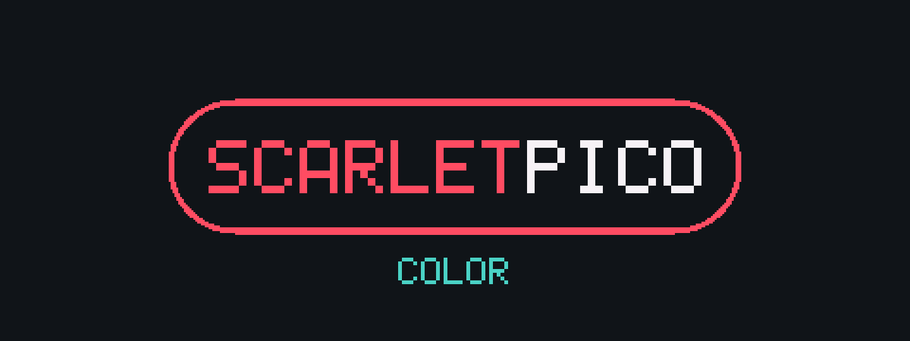
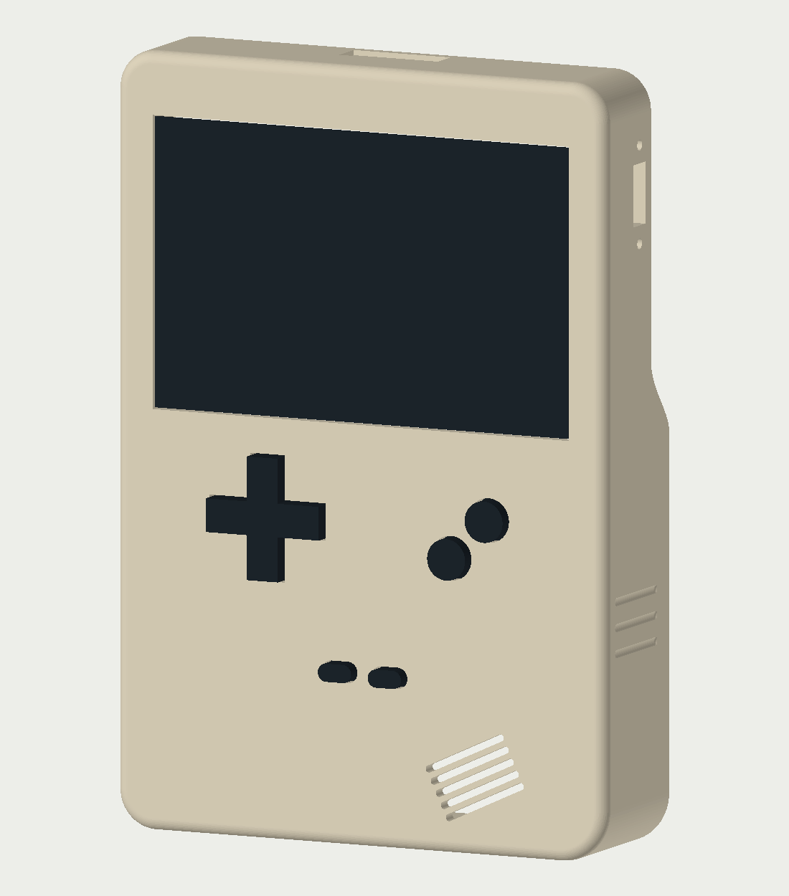
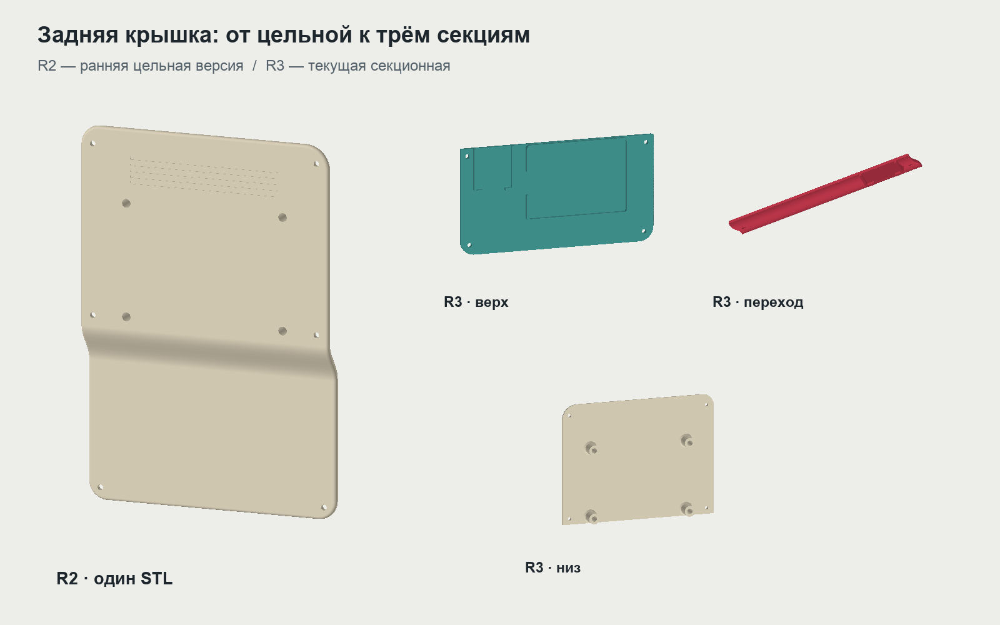
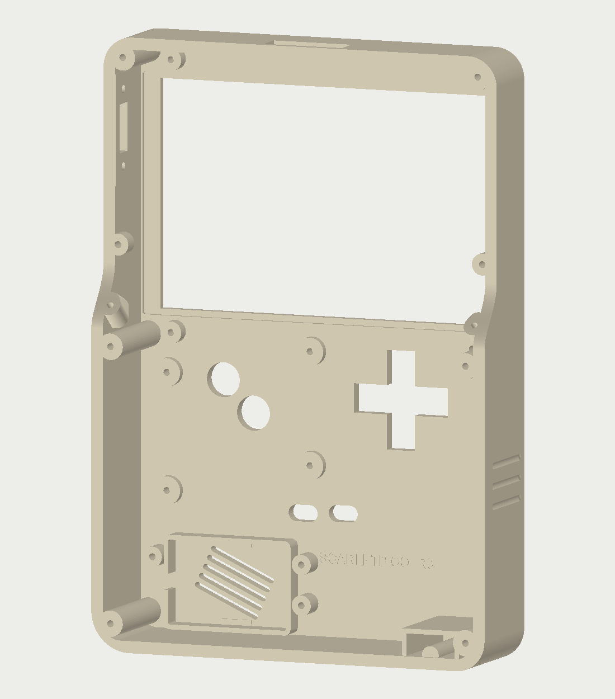

  

  <b>Своя портативная консоль. Свой корпус. Большая любовь к маленьким играм.</b> 
  RP2040 · Game Boy / Game Boy Color · 3D-печатный корпус · Сделано на энтузиазме

  <a href="docs/FLASHING.md">Установка прошивки</a> ·
  <a href="docs/PINOUT.md">Распиновка и схема</a> ·
  <a href="hardware/case/LATEST.md">Модели для печати</a> ·
  <a href="DEVELOPMENT.md">Разработка</a>

## 🎮 Проект

**ScarletPico Color** — самодельная портативная приставка в духе Game Boy:
цветной экран, настоящая крестовина, физические кнопки, динамик и игры на
microSD. Внутри — микроконтроллер Raspberry Pi **RP2040** на компактной
плате RP2040-Zero, а не одноплатный компьютер с Linux.

Это не коммерческий продукт и не готовый набор для сборки. Проект вырос
из желания сделать собственную консоль: спаять электронику, разработать
корпус, напечатать его и довести ощущения от кнопок до состояния «ещё одну
партию — и всё». На голом энтузиазме, через примерки, ошибки и новые ревизии.

Сейчас приставка запускает игры **Game Boy и Game Boy Color** — портативных
систем 8-битной эпохи. Сам RP2040 — 32-битный микроконтроллер; это не означает
поддержку всех 16-битных консолей. NES, SNES, GBA и более мощные системы
в текущую прошивку не входят.

Следующий этап — переход на **RP2350**. Экспериментальный порт уже сохранён
в проекте; адаптация под новую плату и проверка на настоящем устройстве ещё
впереди. Сейчас актуальная прошивка предназначена именно для RP2040.

  

*Рендер реальных STL: передняя часть R3, кнопки и условный выключенный
дисплей. Цвета иллюстративные; это не фотография готового изделия.*

## Что уже умеет приставка

- **GB / GBC с microSD.** Библиотека игр, русский и английский интерфейс,
  запуск через A или Start, обновление списка без перезапуска.
- **Сохранения.** Сохранение картриджной памяти и пять слотов снимков состояния.
- **Звук.** I2S-усилитель MAX98357A, динамик и настройка громкости.
- **Пауза и настройки.** Удержание Start + Select открывает игровое меню;
  доступны настройки, сохранение, загрузка и возврат в библиотеку.
- **Аккумулятор на экране.** Значок батарейки и напряжение в меню и во время
  игры. Измерение через GP29, делитель и фильтрующий конденсатор.
- **Своя заставка.** Пиксельный логотип опускается в центр экрана под короткий
  стартовый звук. Start позволяет пропустить заставку.

В **2.2.7** обновлено оформление библиотеки, сокращена лишняя перерисовка и
уменьшены задержки интерфейса. Это улучшение меню, а не обещание одинакового
FPS во всех играх. Совместимость и скорость зависят от ROM и его контроллера
памяти; универсальной поддержки всего каталога GB/GBC пока нет.

Посмотреть настоящую анимацию заставки

Кадры сняты с исполнения ARM-кода с моделируемым LCD, не нарисованы отдельно
для README. GIF без звука; после заставки устройство открывает меню.

## Внутри

| Узел | Что используется |
|---|---|
| Процессорная плата | RP2040-Zero, Raspberry Pi RP2040 |
| Экран | SPI TFT 3,5″, ST7796, 480 × 320 |
| Хранилище | microSD по общей с дисплеем шине SPI |
| Управление | 8 тактовых кнопок: D-pad, A/B, Start/Select |
| Аудио | MAX98357A по I2S и небольшой динамик |
| Питание | Одноэлементный Li-ion/LiPo, TP4056 с защитой, повышайка до 5 В |
| Контроль батареи | GP29 / ADC3, два резистора 4,7 кОм и конденсатор |
| Монтаж | Макетные платы и ручная пайка; отдельная заказная PCB не требуется |
| Корпус | Собственная адаптированная конструкция на основе исходной Tinkercad-заготовки |

Подключение, напряжения, SPI-шина, кнопки, звук и делитель — в
**[схеме и распиновке](docs/PINOUT.md)**. Там отмечены детали, зависящие
от конкретной версии купленного модуля и требующие проверки.

## 🛠 Корпус

Корпус дорабатывался под реальную сборку: положение кнопок, хват, батарею,
дисплей, динамик и выносной USB-C. Скруглённые грани, более тонкая верхняя
часть сзади и плавный переход снизу помогают удобно держать консоль.
Три неглубокие канавки на каждой боковине добавляют фактуру, не выходя за
габарит. Внутреннее ушко для шнурка также не выступает наружу.

**Габарит корпуса — 103 × 150 × 30 мм**, без выступающих кнопок.
Для внутреннего крепежа предусмотрены саморезы по пластику **M2 × 6 мм**;
крепёж электронного бутерброда отдельный, под его существующие проставки.

| Вариант | Для чего он оставлен |
|---|---|
| **Цельная задняя крышка R2** | Ранняя конструкция без межсекционных швов. Оставлена для сравнения; поднятая область при печати на поддержках получалась грубой. |
| **Задняя крышка R3 из трёх частей** | Верх, изогнутый переход и низ — три отдельных STL. Разделение позволяет иначе ориентировать поверхности и уменьшить следы поддержек. Каждая секция крепится к передней части. |
| **Передняя часть R3** | Стойки LCD 3 мм, дополнительные точки стяжки, крепления экрана и динамика, USB-C, выключатель, внутреннее ушко и боковые канавки. |
| **Кнопочный узел** | Декоративные кнопки и общая пластина с тонкими упругими участками. Сохранены тестовый стенд и предыдущие раздельные держатели. |

Посмотреть переднюю часть изнутри

Дисплей и динамик удерживаются съёмными прижимами изнутри, без необходимости
приклеивать их к корпусу. Подробности — в инструкции соответствующей ревизии.

**Что печатать:** [актуальный список моделей и оговорок](hardware/case/LATEST.md).
**Как собрать:** [инструкция R3](hardware/case/rev3-split/README.md).

R3 пока остаётся примерочной ревизией. У общей кнопочной пластины есть
известные оговорки по окнам D-pad и длине пружин A; они описаны в перечне.
Цельная R2 и секционная R3 — не взаимозаменяемые наборы наугад: выбирать
согласованный комплект. Красивый рендер не заменяет проверку посадок и хода.

## ⚡ Прошивка

Актуальный файл: **[ScarletPico 2.2.7 · RP2040 · UF2](firmware/releases/2026-10-20-rp2040-ui-polish/ScarletPico-v2_2_7-RP2040-UI-POLISH.uf2)**.

1. Выключить приставку и отключить аккумулятор / внешнее питание сборки.
2. Зажать **BOOT / BOOTSEL** на RP2040-Zero и подключить USB-кабель с передачей
   данных. Отпустить BOOT после появления диска **RPI-RP2**.
3. Скопировать `.uf2` на **RPI-RP2**, не на microSD. После записи плата
   перезапустится, а диск исчезнет — это нормальное поведение загрузчика.
4. Отсоединить USB, восстановить штатное питание и проверить запуск.

**[Полная инструкция](docs/FLASHING.md)** — загрузка файла с GitHub,
microSD, первая проверка и безопасный откат.

| Версия | Назначение |
|---|---|
| [2.2.7](firmware/releases/2026-10-20-rp2040-ui-polish/README-RU.md) | Текущая версия с новым UI; ARM-тесты пройдены, полная физическая приёмка ещё нужна. |
| [2.2.6](firmware/releases/2026-10-20-rp2040-legacy222-battery/README-RU.md) | Предыдущая рабочая основа с GP29-батарейкой, для отката. |
| [2.2.2](firmware/releases/2026-10-07-rp2040-native-menu/01-ScarletPico-v2_2_2-RP2040-ROLLBACK.uf2) | Проверенная на приставке версия до добавления батарейки. |

Не прошивать RP2040 файлами для RP2350. Старые экспериментальные UF2
сохранены для истории, но не являются рекомендуемыми обновлениями.

## Куда развивается проект

- Довести посадки и ощущения от кнопок после физических тестов.
- Проверить 2.2.7 на собранной приставке: игры, звук, сохранения и батарейку.
- Перенести актуальные функции на RP2350 и сравнить поведение на новой плате.
- Упростить повторную сборку и постепенно привести проект к цельной,
  воспроизводимой исходной базе.

Предложения по механике, удобству, интерфейсу и схеме приветствуются.
Особенно полезны конкретные наблюдения: какая плата и ревизия корпуса,
версия прошивки, что ожидалось и что получилось. Для проблем печати помогают
материал, ориентация детали и фотография.

### Разработка

- [Исходники, сборка и архитектурные ограничения](DEVELOPMENT.md).
- [UI текущей версии](firmware/ui-polish-addon/) и [монитор батарейки](firmware/battery-legacy-addon/).
- [Экспериментальный порт RP2350](firmware/imported/scarletpico-rp2350-source/).
- [История прошивки](firmware/README.md) и [проверки 2.2.7](firmware/releases/2026-10-20-rp2040-ui-polish/VALIDATION.md).

Текущая 2.2.7 использует наши C/ASM-дополнения поверх закреплённой бинарной
базы — это не полная исходная пересборка старого эмулятора. База и сборщики
сохранены; подробности вынесены в документацию разработчика.

---

ScarletPico — независимый любительский проект, не связанный с Nintendo.
Используется стороннее ядро эмуляции; его авторство и лицензии сохранены в
исходниках зависимостей. ROM-ы игр и сохранения в репозиторий не входят.
