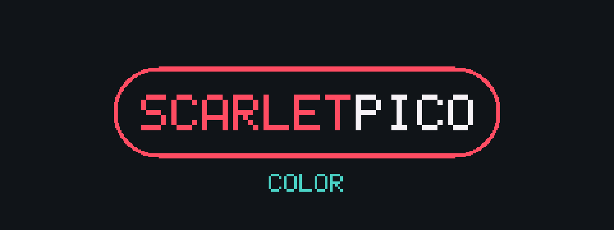
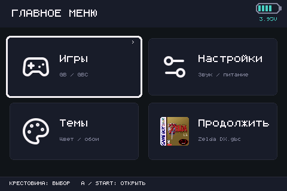
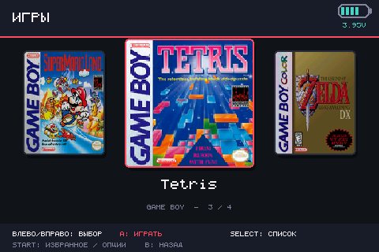
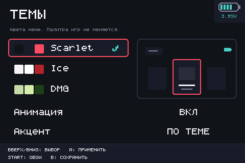
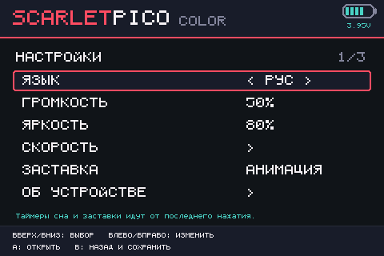
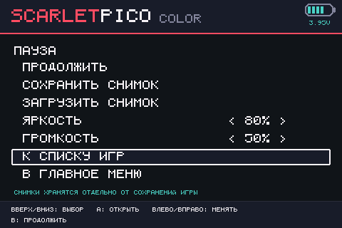
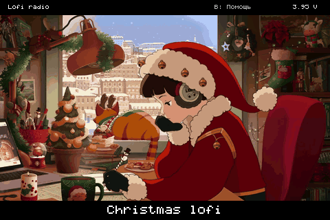
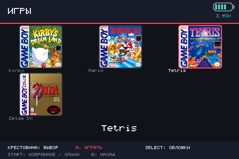
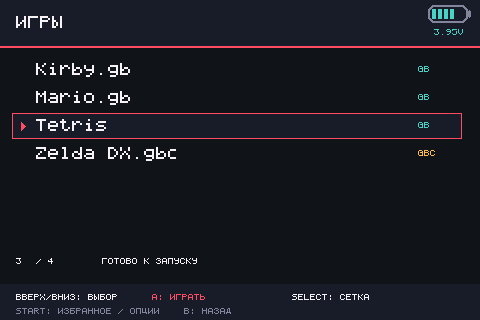
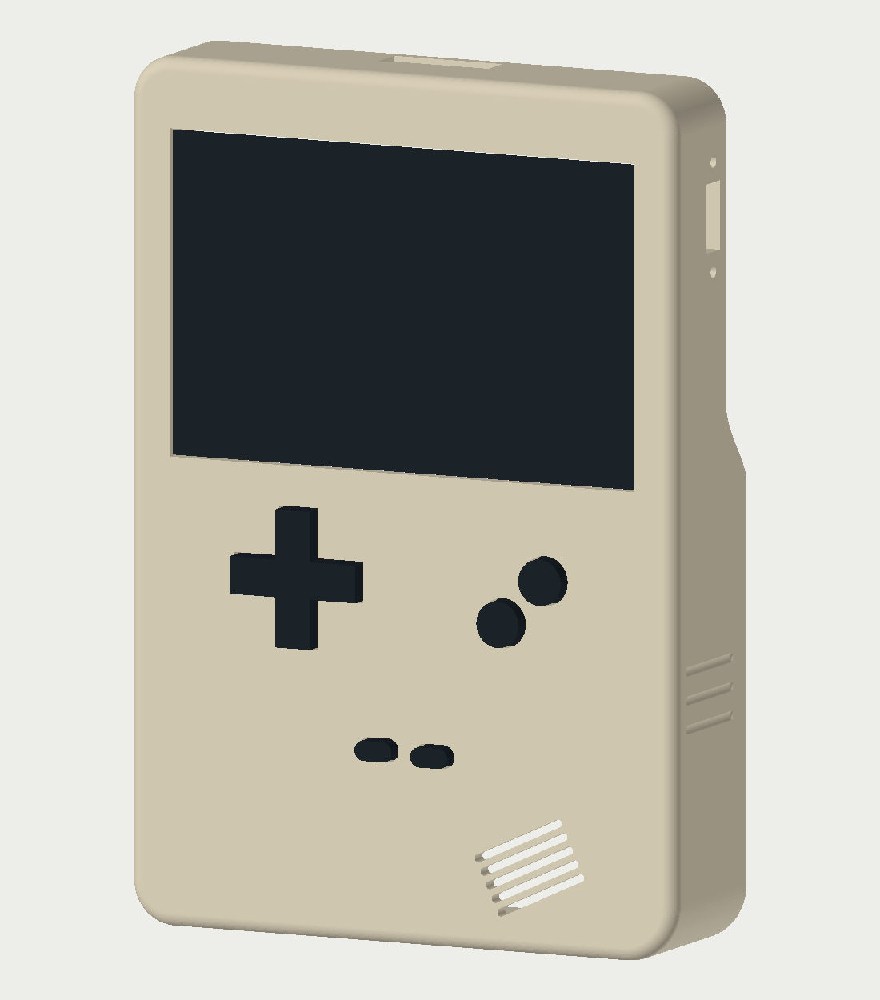

<p align="center"></p>
<p align="center"><b>Русский</b> · <a href="README.en.md">English</a></p>
<p align="center"><b>Маленькая консоль. Большая коллекция. Ещё одна партия.</b><br>Самодельная портативная Game Boy / Game Boy Color на RP2350.</p>
<p align="center">
  
  
  
  
</p>
<p align="center">
  <a href="firmware/releases/2026-11-18-rp2350-lofi-entry-guard/ScarletPico-v3_6_3-RP2350.uf2"><b>Скачать прошивку</b></a> ·
  <a href="docs/FLASHING.md">Как установить</a> ·
  <a href="docs/USAGE.md">Как пользоваться</a> ·
  <a href="#интерфейс">Посмотреть интерфейс</a>
</p>

---

ScarletPico Color — личный DIY-проект: настоящая крестовина, физические
кнопки, цветной экран, динамик, microSD и собственный печатный корпус.
Внутри — **микроконтроллер**, не Linux-компьютер. Проект вырос из ручной
пайки, примерок корпуса и желания сделать удобную приставку для любимых игр.

**Текущая платформа — Waveshare RP2350-USB-A с 74HC165.** Переход с RP2040
уже состоялся. Поддерживаются GB/GBC; NES, SNES и GBA в эту прошивку не входят.
Совместимость и скорость зависят от игры: обещания «весь каталог в 60 FPS» нет.

## Интерфейс

<table>
  <tr>
    <td width="50%"><br><b>Всё начинается здесь</b><br>Четыре плитки, заметное выделение и обложка последней игры.</td>
    <td width="50%"><br><b>Библиотека с обложками</b><br>Горизонтальное перелистывание, избранное и несколько видов каталога.</td>
  </tr>
  <tr>
    <td><br><b>Под своё настроение</b><br>Три палитры, акцентный цвет, обои с карты и отключаемая анимация.</td>
    <td><br><b>Под свои привычки</b><br>Язык, звук, яркость, таймеры, заставки и параметры питания.</td>
  </tr>
  <tr>
    <td><br><b>Продолжить там, где остановился</b><br>Снимки состояния, быстрые регулировки и два варианта выхода.</td>
    <td><br><b>А можно просто отдохнуть</b><br>Локальная музыка и анимированные сцены в скрытом Lofi Radio.</td>
  </tr>
</table>

*Программные снимки интерфейса 3.6.3 в родных **480 × 320**: выполнен
ARM-код прошивки, вывод LCD смоделирован. Не фотографии дисплея и не
дизайн-макеты. Имена игр и показание 3,95 В заданы для демонстрации;
картинки не подтверждают FPS на устройстве. [Происхождение изображений](docs/assets/README.md).*

<details>
<summary>Ещё два вида библиотеки: сетка и список</summary>

<p> </p>

Короткое нажатие **Select** в библиотеке переключает карусель → список → сетку.

</details>

## Что умеет приставка

| Играть | Настроить | Сделать паузу |
|---|---|---|
| GB/GBC с microSD; каталог подгружается порциями | Русский / English, громкость и яркость | Пять ручных слотов снимков состояния |
| Обложки, недавние игры и избранное в начале списка | Scarlet / Ice / DMG, акценты и обои | Автоматическое продолжение при доступном сохранении |
| Отдельные профили громкости, масштаба и CPU для игр | Вид библиотеки, звуки меню и анимация | Заставки, сон дисплея и программная перезагрузка |

- **Выделение не только цветом:** активная плитка увеличивается и получает
  контрастную рамку — выбор проще различить при нарушениях цветовосприятия.
- **Без карты меню не исчезает:** настройки и встроенные темы доступны;
  разделы, которым нужны файлы, сообщают об их отсутствии и позволяют вернуться.
- **Аккумулятор на виду:** скруглённый индикатор и напряжение. При устойчивом
  низком напряжении — предупреждение и короткий звук с учётом громкости.
- **Lofi Radio без сети:** WAV с карты и подготовленные анимации. Название
  «radio» не означает интернет-радио, Wi-Fi для этой функции не нужен.

## Быстрый старт

1. **Проверить плату и разводку.** Этот UF2 — только для текущей сборки
   **RP2350-USB-A + 74HC165**, не для произвольной платы RP2350 или RP2040.
2. **[Установить 3.6.3](docs/FLASHING.md)** через BOOTSEL и USB с передачей данных.
   UF2 копируется на диск загрузчика **RP2350**, не на microSD.
3. На выключенной приставке вставить FAT16/FAT32-карту с собственными
   `.gb` / `.gbc` в `/roms`. Работающую карту ради обновления не форматировать.
4. Открыть **Игры → Все игры**, выбрать игру и нажать **A**.
5. Для паузы удерживать **Start + Select** около 1,5 секунды.

### Основные кнопки

| Где | Действие |
|---|---|
| Главное меню | Крестовина — выбор; **A / Start** — открыть |
| Карусель игр | **← / →** — перелистывание; **A** — запуск |
| Библиотека | **Select** — смена вида; **Start** — избранное и параметры игры; **B** — назад |
| Настройки | **↑ / ↓** — пункт; **← / →** — значение; **A** — открыть; **B** — назад и сохранить |
| Во время игры | Удерживать **Start + Select** — пауза |
| Сон / обычная заставка | Любая кнопка — пробуждение / возврат |

**Хотите Zelda в начале списка?** Выделить её → **Start → Избранное → Да**.
Игра останется в общей коллекции, но поднимется в начало; также появится
в **Игры → Избранное**. [Полное руководство →](docs/USAGE.md)

## Тихий режим: Lofi Radio

Положить музыку в **`/lofiplayer/music`** и удерживать **Select 1,5 с в главном
меню**. В 3.6.3 без непустых WAV-файлов или без microSD не происходит ничего:
скрытая функция не открывает пустой экран и не показывает ошибку.

| Кнопки | Действие |
|---|---|
| **A / Start** | Пауза / продолжение после отпускания кнопки |
| **← / →** | Предыдущий / следующий трек |
| **↑ / ↓** | Громкость |
| Удерживать **A** + **← / →** | Предыдущая / следующая анимированная сцена |
| **B** | Показать / скрыть подсказки |
| Удерживать **Select + Start** | Выйти из Lofi |

Нужен **PCM WAV: 32 000 Гц, 16 бит, стерео**. Анимации — подготовленные
`.lfi` в `/lofiplayer/animation`, не обычные GIF. Музыка и медиапакет не
вшиты в UF2 и не поставляются вместе с ним. [Форматы и файлы →](docs/USAGE.md#файлы-на-microsd)

## Прошивка · 3.6.3

**[Скачать ScarletPico-v3_6_3-RP2350.uf2](firmware/releases/2026-11-18-rp2350-lofi-entry-guard/ScarletPico-v3_6_3-RP2350.uf2)** ·
[Примечания и проверки](firmware/releases/2026-11-18-rp2350-lofi-entry-guard/README-RU.md)

**Новое:** тихая проверка наличия музыки перед входом в Lofi, один раз за
удержание Select. Остальные функции линии 3.6.2 сохранены.

Сборка, host-тесты и целевые ARM-тесты прошли. **Именно 3.6.3 ещё не прошита
и не проверена на физической приставке** на момент публикации. Снимки UI
и результаты эмулятора не заменяют аппаратную проверку.

<details>
<summary>Контрольная сумма и предыдущая платформа</summary>

Размер UF2: **473 600 байт**. SHA-256:

```text
66577c0a8a363faa4b5ddea6b08e0b8a6e8b341434a51fdb3d17699e353141f5
```

Для прежней сборки RP2040 сохранена
[2.2.8](firmware/releases/2026-10-22-rp2040-library-paging/README-RU.md).
Это отдельная историческая ветка, **не откат для RP2350**. Файлы разных
процессоров и разных разводок не взаимозаменяемы.

</details>

## Внутри корпуса

| Узел | Текущая сборка |
|---|---|
| Процессорная плата | Waveshare RP2350-USB-A, RP2350, 2 МБ flash |
| Экран | SPI TFT ST7796, 3,5″, 480 × 320 в горизонтальной ориентации |
| Кнопки | D-pad, A/B, Start/Select через 74HC165 |
| Хранилище | microSD; общая SPI-шина с дисплеем |
| Аудио | I2S MAX98357A и динамик |
| Питание | Одноэлементный Li-ion/LiPo, зарядка с защитой и питание сборки |
| Монтаж | Две макетные платы 50 × 70 мм, кнопки отдельно |
| Корпус | 3D-печатный; для текущей сборки выбрана цельная задняя крышка |

<details>
<summary>Корпус и история конструкции</summary>



Исторический рендер R3 из реальных STL, **не фотография текущей сборки**.
[Архив моделей](hardware/case/README.md) содержит и цельные, и секционные
варианты; не смешивать детали разных ревизий без проверки совместимости.
Старый список STL не означает, что всё надо перепечатать.

</details>

**Важно для повторной сборки:** [старая распиновка](docs/PINOUT.md) описывает
RP2040; её нельзя автоматически переносить на RP2350. Питание USB и
аккумулятора требует согласованной развязки. Зарядный разъём корпуса не
становится разъёмом прошивки без подключения линий данных. Во время работы
не вынимать и не вставлять microSD.

## Документация и авторство

- [Руководство пользователя](docs/USAGE.md) — библиотека, сохранения, темы, Lofi и сон.
- [Установка и проверка прошивки](docs/FLASHING.md) — BOOTSEL, microSD, питание и откат.
- [Историческая разработка](DEVELOPMENT.md) — база RP2040 и ранний порт; не инструкция воспроизведения сборки 3.6.3.
- [Источники иллюстраций](docs/assets/README.md) — что снято из кода, а что является CAD-рендером.

ScarletPico — независимый любительский проект, не связанный с Nintendo или
Lofi Girl. Имена, персонажи и обложки принадлежат своим правообладателям.
Новогодняя сцена в снимке Lofi — **Lofi Girl / Studio Lofi Girl**.
Иконки интерфейса — **Lucide**, ISC; уведомление о лицензии сохранено.
Авторство и лицензии стороннего ядра эмуляции остаются в исходниках.
**ROM-ы, сохранения, музыкальные записи и полные сторонние анимации не публикуются.**
