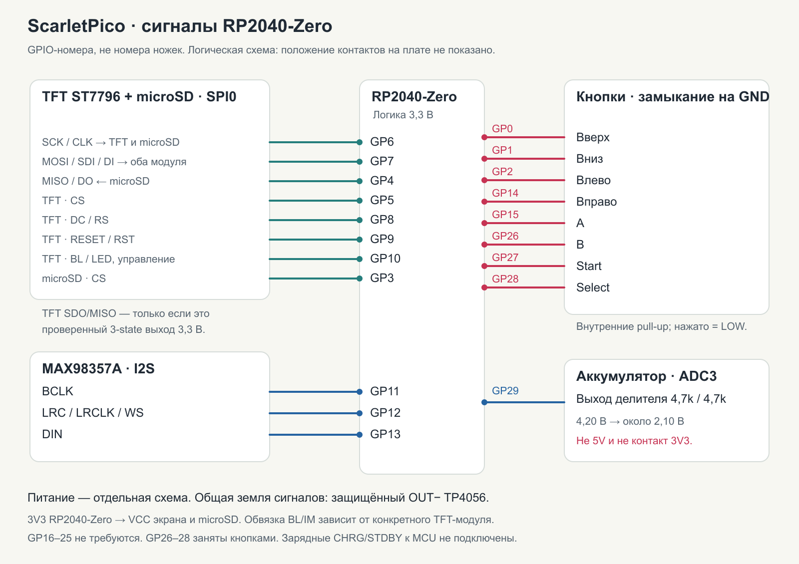
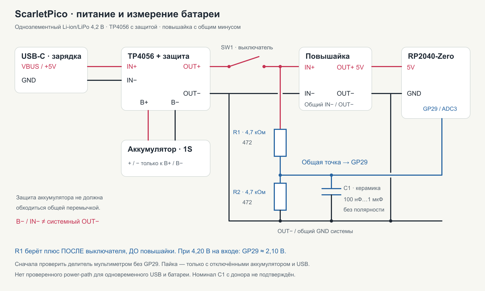

# ScarletPico · схема подключения и распиновка

[← О проекте](../README.md) · [Установка прошивки](FLASHING.md)

Монтажная схема прототипа **RP2040-Zero / ST7796 / MAX98357A / 2.2.7**.
Это схема соединения готовых модулей, не Gerber и не проект заказной PCB.
Она отражает назначения рабочей линии прошивки и подтверждённый путь
измерения батареи; не заменяет прозвонку реальной ручной пайки.

**GP — номер GPIO микроконтроллера, не порядковый номер контакта платы.**
Например, GP29 — площадка «29», а не «3V3» и не 29-я ножка разъёма.
У RP2040-Zero внешние контакты идут не подряд: GP16–25 для этой сборки
не нужны. Переносить рисунок контактов обычного Raspberry Pi Pico на Zero
или другой клон нельзя.

## Сигналы



[Открыть SVG крупно](assets/wiring-signals.svg). Рисунок логический:
он не показывает физическое расположение контактных площадок.

### Экран и microSD — общая SPI0

| RP2040-Zero | Экран ST7796 | microSD в SPI-режиме |
|---|---|---|
| **GP6** | SCK / CLK | SCK / CLK |
| **GP7** | SDI / MOSI / SDA¹ | DI / MOSI / CMD |
| **GP4** | SDO / MISO — только при необходимости и проверенной развязке² | DO / MISO / DAT0 |
| **GP5** | CS | — |
| **GP8** | DC / RS | — |
| **GP9** | RESET / RST | — |
| **GP10** | BL / LED — логическое управление подсветкой³ | — |
| **GP3** | — | CS / DAT3 |

¹ `SDA` на некоторых SPI-дисплеях означает serial data input, а не шину I²C.
Общие SCK/MOSI не означают общий CS: у TFT и microSD разные линии выбора.

² Для записи изображения SDO экрана не требуется. На общей MISO должен
оставаться только корректный выход 3,3 В, переходящий в высокоимпедансное
состояние при снятом CS. Не соединять непроверенные выходы модулей друг
с другом. В минимальной схеме GP4 идёт к microSD.

³ GP10 — сигнал управления, **не источник питания светодиодов подсветки**.
Прямое подключение возможно только к входу BL с подходящей схемой на модуле.
Для голой подсветки нужен рассчитанный драйвер/ключ и ограничение тока.

### Питание дисплея и карты

- **microSD:** в собранном прототипе питание модуля взято с **3V3** RP2040-Zero;
  GND — общая системная земля. Это не универсальное указание для всех
  модулей: платы с входным стабилизатором могут требовать другое VIN.
- **TFT VCC:** в собранном прототипе подключён к **3V3** RP2040-Zero,
  как и питание microSD; подтверждено владельцем 20 октября 2026.
  GND экрана — общая системная земля. Это подключение конкретного модуля,
  не универсальное требование для всех TFT-плат. Сигнальная логика — 3,3 В.
- **IM / выбор интерфейса TFT:** некоторые контакты выбора режима уже
  привязаны к 3V3 в существующей сборке. Их номера зависят от платы TFT и
  здесь не выдумываются. Перед повторением нужны её схема/маркировка.
- **3V3 — общая шина питания, а не GPIO.** Несколько подходящих нагрузок
  могут питаться от неё в пределах бюджета стабилизатора. Отдельный свободный
  «пин 3V3» для делителя не требуется: сигнал измерения идёт именно на GP29.

На [схеме оригинальной RP2040-Zero](https://files.waveshare.com/upload/4/4c/RP2040_Zero.pdf)
показаны стабилизатор и GPIO29/ADC3. Плата-клон может отличаться. Не считать
максимальный ток микросхемы стабилизатора гарантированным свободным током
выхода при уже подключённых нагрузках.

### Кнопки

| Действие | GPIO | Второй контакт |
|---|---|---|
| Вверх | **GP0** | GND |
| Вниз | **GP1** | GND |
| Влево | **GP2** | GND |
| Вправо | **GP14** | GND |
| A | **GP15** | GND |
| B | **GP26** | GND |
| Start | **GP27** | GND |
| Select | **GP28** | GND |

Все кнопки нормально разомкнутые, используются внутренние подтяжки вверх:
отпущена — HIGH, нажата — GPIO соединён с GND, LOW. Не подавать 5 В на кнопки.
У четырёхногой тактовой кнопки часть ножек уже соединена внутри; сначала
прозвонить, чтобы не получить постоянно нажатую кнопку.

### Звук MAX98357A

| RP2040-Zero / питание | MAX98357A |
|---|---|
| **GP11** | BCLK |
| **GP12** | LRC / LRCLK / WS |
| **GP13** | DIN |
| Регулированные **5 В** после повышайки | VIN |
| Общая земля OUT− | GND |
| Динамик, два провода | SPK+ и SPK− |

**Ни один вывод динамика не подключать к GND:** усилитель мостовой.
GAIN и SD/SD_MODE зависят от обвязки конкретной платы; прошивка их отдельными
GPIO не управляет. Не привязывать их произвольно к 5 В. MCLK не требуется.
Эти особенности описаны в
[datasheet MAX98357A](https://www.analog.com/media/en/technical-documentation/data-sheets/MAX98357A-MAX98357B.pdf).

## Питание



[Открыть схему питания крупно](assets/wiring-power.svg).
**Точка на пересечении — электрическое соединение. Пересечение без точки
не означает соединения.** Внутренняя схема защиты TP4056 здесь не раскрыта.

| Откуда | Куда |
|---|---|
| Аккумулятор + / − | TP4056 **B+ / B−** |
| Выносной зарядный USB-C VBUS / GND | TP4056 **IN+ / IN−**, по маркировке платы |
| TP4056 **OUT+** | Вход выключателя питания |
| Выход выключателя | Повышайка **IN+** и верх R1 делителя |
| TP4056 **OUT−** | Повышайка **IN−**, общая системная земля |
| Повышайка **OUT+**, настроенная на 5 В | Контакт **5V** RP2040-Zero, VIN MAX98357A |
| Повышайка **OUT−** | GND RP2040-Zero, GND усилителя и остальных сигнальных узлов |
| Выход **3V3** RP2040-Zero | **VCC экрана** и питание установленного **microSD-модуля** |

Выключатель находится **до повышайки**, чтобы её светодиод и сама схема
не оставались постоянно включёнными. Схема предполагает обычную повышайку
с общим IN−/OUT−. Её выход сначала настроить и измерить **без процессорной
платы**. Плюс аккумулятора напрямую на 5V или 3V3 RP2040 не подавать.

Для шестиконтактного выключателя не угадывать пары по расположению:
прозвонить, какие контакты замыкаются в каждом положении. Центральная пара
обычного DPDT — общие контакты, не отдельное «нейтральное питание».

**B− и OUT− не соединять перемычкой.** У защищённого TP4056 это может
обойти отключающие MOSFET-ы. Общая земля сигнальной части берётся с **OUT−**,
а не дополнительно с минуса ячейки или IN− зарядки.

Выносной USB-C здесь — **только зарядный вход**, не порт прошивки.
Для плат USB-C проверяются VBUS/GND и корректная обвязка CC для питания
от выбранного кабеля; четыре контакта разъёма сами по себе её не гарантируют.
Не подключать D+/D− зарядного входа к GPIO.

## Делитель батареи → GP29

```text
                  после выключателя, ДО повышайки
                               │
                        R1 = 4,7 кОм  «472»
                               │
                               ●──────────── GP29 / ADC3
                               │       │
                        R2 = 4,7 кОм   C1
                            «472»      │
                               │       │
OUT− / системный GND ───────────●───────●
```

- Два одинаковых **472 = 4 700 Ом**, по одному сверху и снизу.
- C1 включён **параллельно R2**, между GP29 и GND, а не последовательно
  с проводом измерения. Для этой фильтрации ориентир — керамика 100 нФ…1 мкФ.
  Реальная ёмкость использованной детали с донора не подтверждена.
- Вход делителя берётся после выключателя, чтобы постоянно живой
  аккумулятор не подпитывал выключенный MCU через ADC.
- При двух равных резисторах `V_ADC ≈ V_аккумулятора / 2`:
  **4,20 В → 2,10 В**, **3,70 В → 1,85 В**.
- Проверить эти уровни мультиметром **до соединения с GP29**, затем
  обесточить сборку и подключить сигнал. Не подавать на ADC 5 В или
  неразделённое напряжение аккумулятора. Допуски ADC и напряжения —
  в [datasheet RP2040](https://datasheets.raspberrypi.com/rp2040/rp2040-datasheet.pdf).

[Крупная иллюстрация именно двух резисторов 472](../hardware/battery-monitor/divider-472-wiring.png).

Прошивка показывает приблизительные полоски и напряжение с номинальной
опорой 3,3 В, а не измеренный остаток в процентах. Сверить с мультиметром;
сотые доли на экране не означают точность до сотой вольта.

**CHRG/STDBY и LED-площадки TP4056 не подключены к RP2040.** Текущая версия
не определяет кабель и окончание зарядки. Подключать LED-площадки напрямую
опасно для логики 3,3 В; эта схема такой доработки не содержит.

## Перед включением

1. Аккумулятор и оба USB отключены во время пайки.
2. Проверены полярность, отсутствие коротких замыканий и положение выключателя.
3. Выход повышайки измерен без нагрузки MCU и выставлен на 5 В.
4. Делитель проверен относительно OUT−: на выходе половина напряжения.
5. Нет перемычки B− → OUT− и 5 В на GPIO/ADC.
6. Динамик подключён только между SPK+ и SPK−.
7. При USB-прошивке штатное питание сборки отключено.

TP4056 не является автоматически контроллером power-path/load-sharing.
Одновременная игра и зарядка, ток зарядки, защита, нагрев и допустимые токи
конкретной ячейки/преобразователя этой схемой не сертифицированы. Не оставлять
самодельную сборку на зарядке без присмотра и не использовать повреждённую
или вздутую ячейку.

## Откуда взята распиновка

Назначения сверены между `firmware/include/config.h`, конфигурацией
импортированного порта и сохранённым I2S-кодом рабочей бинарной линии;
GP29 — из `firmware/battery-legacy-addon/battery.c`. LCD/SD/аудио/кнопочные
назначения 2.2.7 не изменяла. Физическая пайка целиком здесь не прозванивалась.
Старый [HARDWARE-BATTERY.md](HARDWARE-BATTERY.md) содержит исторические
варианты, включая отвергнутые подключения; для повторения использовать
эту страницу, не смешивать схемы разных этапов.
