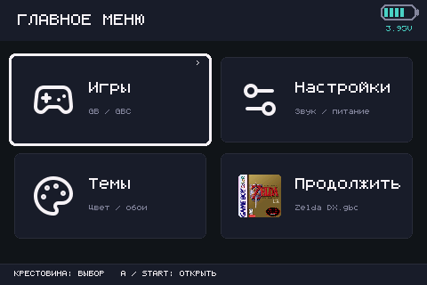
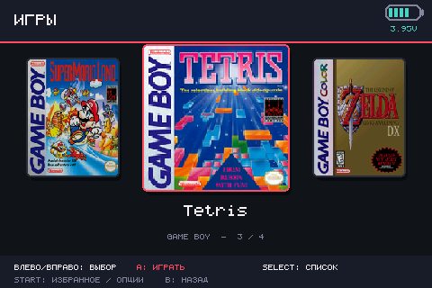
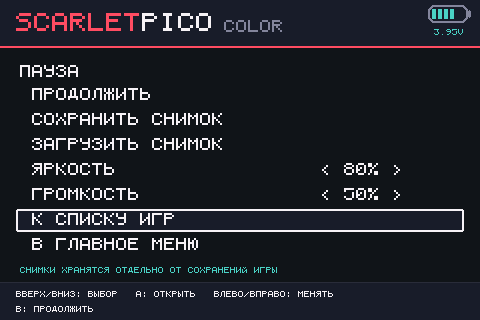
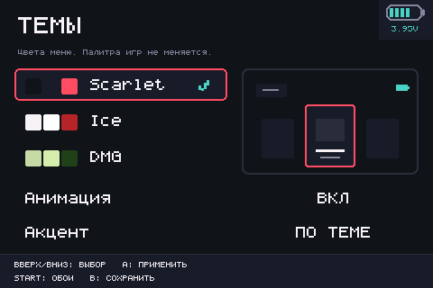
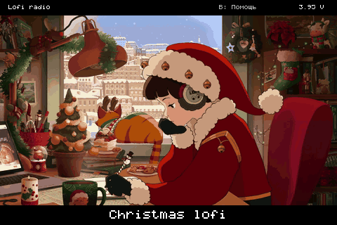
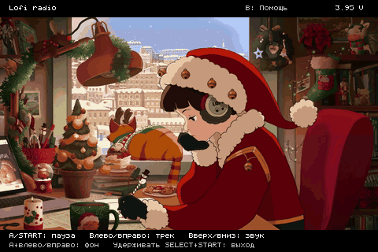

# ScarletPico · руководство пользователя

[← О проекте](../README.md) · [Установка](FLASHING.md)

Для RP2350, прошивка **3.6.3**. Кнопки описаны по реальному коду;
иллюстрации — программные кадры ARM-интерфейса, не фотографии дисплея.

## Главное меню



Крестовиной выбрать плитку, **A или Start** — открыть.

- **Игры:** все игры, недавние и избранное.
- **Настройки:** язык, звук, яркость, производительность, заставки и питание.
- **Темы:** Scarlet, Ice, DMG; анимация, акцент и выбор обоев.
- **Продолжить:** последняя доступная сохранённая сессия. Если её нет,
  появляется понятное сообщение; это не неисправность. Обложка требует
  соответствующего файла на карте.

## Библиотека и избранное



- **← / →** в карусели — предыдущая / следующая игра.
- **A** — запуск; **Start** — избранное и параметры выбранной игры.
- **Select** — карусель → список → сетка. В списке перемещаться вверх/вниз,
  в сетке — крестовиной.
- **B** — назад; из вложенной папки сначала возвращает на уровень выше.

Чтобы закрепить игру, открыть **Start → Избранное**, изменить на **Да**,
вернуться через **B**. Избранные идут первыми; звёздочка помогает их отличить.
Есть отдельный раздел **Игры → Избранное**. Поддерживается до 32 избранных
и 12 недавних игр; общий каталог ROM этим не ограничен.

В параметрах игры можно выбрать собственную громкость, масштаб и профиль
CPU либо оставить **Общая / Общий**. Само добавление в избранное ROM не меняет.

## Игра, пауза и сохранения



Удерживать **Start + Select** около 1,5 секунды. В паузе доступны продолжение,
запись/загрузка снимка, яркость, громкость и два разных выхода:

- **К списку игр** — вернуться в библиотеку.
- **В главное меню** — вернуться к четырём плиткам.

Сохранение самой игры и снимок состояния — разные вещи. Ручных слотов
снимков пять; автоматическое продолжение использует отдельный слот.
Если запись не удалась, не отключать питание сразу: прочитать сообщение,
вернуться или повторить. Снимки не гарантированно совместимы со всеми
будущими версиями; резервная копия обычного сохранения особенно важна.

## Темы и настройки



**↑ / ↓** — выбрать строку; **A** — применить тему; **Start** — обои;
**B** — сохранить и вернуться. Темы меняют интерфейс, не цвета самой игры.
Анимацию интерфейса можно отключить. Выделение плиток сохраняет рамку и
увеличение, поэтому не зависит только от разницы красного и синего.

В настройках **← / →** меняют значения, **A** открывает подраздел,
**B** сохраняет и возвращает. Страниц несколько: листать вверх/вниз.

### Скорость

Есть профили 125 / 150 МГц и **200 МГц EXP**. Последний — экспериментальный
разгон, не гарантированный безопасный режим для каждого экземпляра.
Для обычной работы начать со 150 МГц; повышенная частота не гарантирует
устранения задержек SD или передачи изображения. При нестабильности
вернуться к штатному профилю. Не менять напряжения ради разгона.

### Заставки, сон и питание

По умолчанию заставка появляется через **1 минуту**, сон — через **5 минут**
от последнего нажатия. Таймеры настраиваются. Сон выключает подсветку и
переводит дисплей в ожидание; это **не физическое отключение аккумулятора**.
Обычная заставка и сон завершаются нажатием любой кнопки.

Записанные заставки и обои требуют соответствующих файлов на microSD.
Можно выбрать встроенную анимацию, запись или фоновую сцену. В настройках
есть ручной запуск фоновой заставки для длительного показа; это отдельный
режим, а не обещание автоматического определения зарядки.

**Настройки → Питание:** сон или программная перезагрузка с подтверждением.
Сначала выйти из игры с успешным сохранением. Напряжение батареи приблизительное:
оно не равно точному проценту заряда и само по себе не подтверждает завершение зарядки.
Устойчивое низкое напряжение вызывает предупреждение и короткий сигнал;
нулевая громкость сохраняет тишину. Программного отключения батареи нет.

## Lofi Radio



Это локальный проигрыватель без интернета. В главном меню удерживать
**Select 1,5 секунды**. В 3.6.3 без непустого `.wav` в `/lofiplayer/music`
вход игнорируется, как и при отсутствии карты. Пустые файлы, каталоги и
служебные файлы с именем на точку не считаются музыкой. Содержимое WAV
проверяется при воспроизведении: неверный формат всё ещё может дать сообщение.

| Кнопки | Действие |
|---|---|
| A / Start, затем отпустить | Пауза / продолжение |
| ← / → | Трек |
| ↑ / ↓ | Громкость |
| Удерживать A + ← / → | Анимированная сцена |
| B | Показать / скрыть подсказки |
| Удерживать Select + Start | Выйти |

<details>
<summary>Как выглядят включённые подсказки</summary>



</details>

Музыка: **PCM WAV, 32 000 Гц, 16 бит, стерео**. В этой версии плеер не
декодирует MP3, M4A, Opus или WebM. Около **461 МБ на час** несжатого аудио;
свободное место проверить заранее. Исходные музыкальные записи выбирать
самостоятельно с учётом прав на их использование.

Сцены: **`.lfi`**, предварительно подготовленные для плеера. Переименование
GIF в LFI не конвертирует файл. Поддерживается до 32 сцен; файлы с
`-backup.` в имени пропускаются. Выбор сцены хранится до выключения.
Полные музыкальные записи и сторонние анимации в этот выпуск не включены.

## Файлы на microSD

FAT16/FAT32. Показана структура текущей RP2350-прошивки; необязательные
медиа можно не устанавливать. Существующие папки и резервные копии не удалять.

```text
microSD/
├── roms/                          собственные .gb / .gbc
├── covers/                        подготовленные .scf
│   └── Zelda.gbc.scf               для ROM с точным именем Zelda.gbc
├── screensavers/                  подготовленные записи .saf
├── scarlet2350/
│   ├── saves/                     сохранения игр / RTC
│   ├── states31/                  снимки состояния
│   ├── themes/                    подготовленные обои .swp
│   ├── collection-a.spc           служебные данные коллекции
│   └── collection-b.spc           вторая копия служебных данных
└── lofiplayer/
    ├── music/                     PCM WAV 32 кГц / 16 бит / стерео
    └── animation/                 подготовленные .lfi
```

Обложка сопоставляется с **полным именем ROM, включая расширение**, плюс
`.scf`. JPEG/PNG нельзя просто переименовать в SCF. Старую папку `/saves`
после перехода с RP2040 также сохранить: она может понадобиться для переноса.
Медиапакет не включён в UF2; отсутствие обложек не препятствует запуску ROM.

## Если что-то не найдено

| Ситуация | Что проверить |
|---|---|
| Игры не видны | FAT16/FAT32, каталог `/roms`, расширения `.gb` / `.gbc` |
| Вместо обложки заглушка | Формат SCF и точное совпадение имени |
| Lofi не открывается | Главное меню, Select 1,5 с, непустые WAV в `/lofiplayer/music` |
| Lofi открыт, музыки нет | PCM 32 кГц / 16 бит / стерео, громкость, отсутствие паузы |
| Не видны обои или записанные заставки | Наличие подготовленных файлов на карте |
| «Продолжить» недоступно | Существование ROM и корректной сохранённой сессии |

Карту вынимать и вставлять **только при выключенной приставке**. После
работы с ней на компьютере — безопасное извлечение. При ошибке записи
сначала сохранить резервную копию и проверить карту, не форматировать её
в надежде автоматически исправить прошивку.
