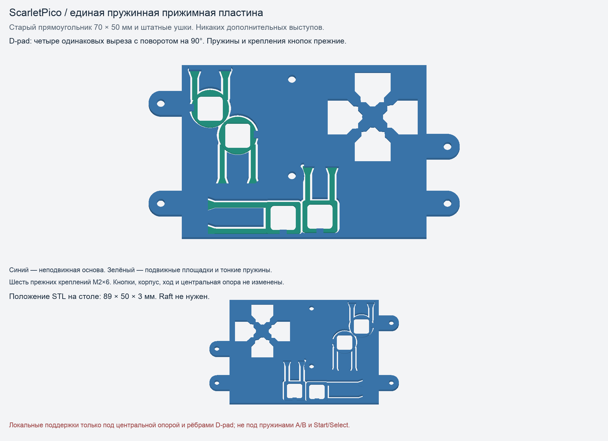

# Общая пластина — строгий прежний контур

**Оговорка после сравнения с исходной цельной R2:** симметричные окна этой версии всё ещё меньше исходных: 84,51 против примерно 100,5 мм² (около −16% по площади), габарит сквозного окна 10,3 × 9,98 вместо 10,3 × 11,67 мм. Первоначальный размер не восстановлен, геометрия при уборке не менялась. Это экспериментальная пластина, не окончательно принятая конструкция. [Актуальный перечень деталей](../../LATEST.md).

[00-RECTANGULAR-SYMMETRIC-DPAD-RETAINER.stl](00-RECTANGULAR-SYMMETRIC-DPAD-RETAINER.stl) — одна связная деталь с четырьмя одинаковыми симметричными окнами D-pad. Основной прямоугольник **70 × 50 мм**, с прежними боковыми крепёжными ушками полный габарит **89 × 50 × 3 мм**. Никаких дополнительных выступов сверху, снизу или сбоку.

**SYMMETRIC-DPAD — последний сохранённый вариант, с оговоркой выше.** Предыдущие CLEAN-STRAIGHT, FULL-OUTLINE и RECTANGULAR перенесены в Корзину при уборке 19 октября. Их исходники сохранены. Текущая геометрия ограничена точным старым прямоугольником и профилями штатных ушек. Это проверено вычитанием старого допустимого объёма и повторно после экспорта STL.

**Четыре окна D-pad теперь одинаковы и переходят друг в друга поворотом на 90° вокруг центра (31,9; 88 мм).** Старый локальный носитель был несимметрично обрезан, а его нижняя связь уменьшала одно окно. Из всех прежних свободных областей собран общий симметричный шаблон: меньшие вырезы увеличены, большие не залиты. Центральная контактная опора и её высота сохранены, подрезаны только края окон. Сквозная лишняя щель ниже узла не возвращена. Экспериментальная вставка дополнительного поджима не включена.

Проверяются симметрия всего объёма внутри крестообразной области, четыре отдельные сквозные области, равенство их площадей и повторно симметрия/площади **готового STL**, а не только исходного CSG. Для площади используется объединение сечений всех постоянных по высоте участков, чтобы исключить численные тени от проекции копланарных треугольников.

Толщина пружин **0,8 мм**, подвижных площадок **1,2 мм**, положения накладок и номинальный ход **0,65 мм** сохранены. **У A и B теперь прямые пружины.** У B и Start/Select рабочая геометрия прежняя. Прямые пружины A помещены внутри прямоугольника: свободная расчётная длина 8,3 мм вместо исходных 10,3 мм, номинальная ширина 1,4 мм. Они могут ощущаться жёстче; физическое усилие не измерено.

Прорези-дуги вокруг крепёжных площадок убраны. Причиной было ошибочное проецирование стоек корпуса из-под плоскости прилегания; новые прорези там не нужны. Оставлены только проходы для саморезов и действительно необходимые прорези рабочих пружин рядом с креплениями.

Широкое неподвижное поле толщиной 3 мм не должно гнуться при каждом нажатии. Сквозные прорези с дополнительным зазором 0,6 мм освобождают рабочие пружины и площадки. Маленькие зажимающие углубления старой R2 не возвращены. Лишние жёсткие участки рамок V2 обрезаны по старому контуру, но сами накладки и их толкатели не менялись.

Корпус, крестовину и четыре накладки из пружинного теста не перепечатывать. Шесть прежних M2×6, те же отверстия и высота креплений. Эта деталь заменяет предыдущую общую пластину или все три раздельные; одновременно их не ставить.

## Печать и проверка

STL уже ориентирован передней стороной на стол, масштаб 100%. **Raft layers: 0.** Тонкие кнопочные пружины и площадки печатаются прямо на столе, без поддержек под ними. Только под центральной опорой и диагональными рёбрами D-pad нужны локальные ручные поддержки, как у предыдущей объединённой версии. Не заполнять поддержками рабочие прорези. Сохранить рабочий PETG-профиль, слой 0,16–0,20 мм; полностью остудить стол перед снятием.

Проверены замкнутость и связность STL, отсутствие выступов за старый контур, четыре равных симметричных окна D-pad, сохранность его центральной опоры и рабочих пружин B/Start/Select, шесть опорных площадок и крепёж, наклоны D-pad, 15 положений хода каждой отдельной кнопки, отсутствие столкновений с передней частью с 3-мм LCD-стойками, LCD-прижимами, платой, микрокнопками и держателем динамика.

**Физическая проверка ещё требуется**, особенно усилие A после укорочения её прямых пружин. Проверять возврат и отсутствие постоянного нажатия с электронной платой, закреплённой на штатной высоте. Устаревшие STL можно восстановить из отдельной папки Корзины, указанной в журнале уборки.

[Отчёт проверок](checks-symmetric-dpad.json). Исходник: `build_full_plate.py`; рендер: `render_springs.py --full-outline`.
